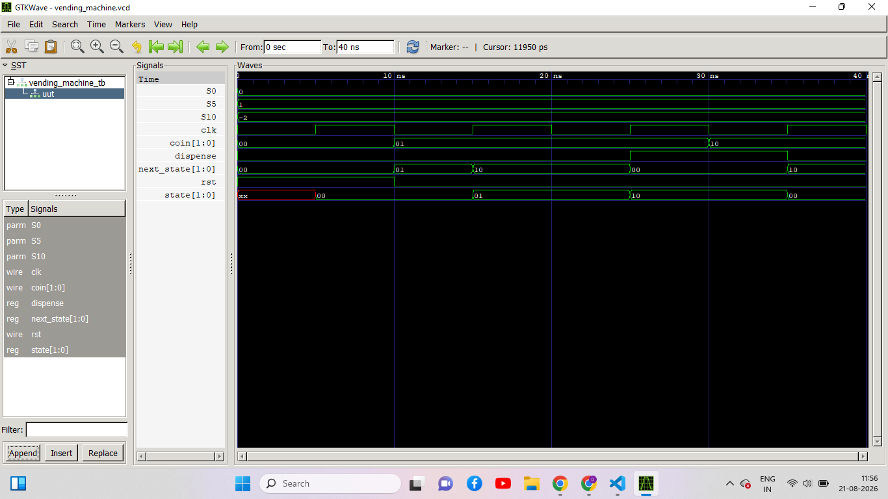

# Vending Machine Controller Using Verilog HDL

## Project Overview
This project implements a digital vending machine controller using Verilog HDL. The design models coin inputs and product dispensing through digital logic and sequential control.

## Objectives
- Design a vending machine controller using Verilog HDL.
- Understand the application of sequential logic in digital systems.
- Implement coin input handling and product dispensing logic.
- Simulate the design to observe its behavior under different input conditions.

## Tools and Technologies
- **Verilog HDL** — RTL design
- **Icarus Verilog** — Simulation
- **GTKWave** — Waveform visualization

## Functional Description
The controller accepts coin inputs and manages the dispensing operation according to the logic implemented in the design. The behavior is controlled by the input signals and the controller's internal logic.

## Project Files
- `vending_machine.v` — Verilog RTL source code.
- `vending_machine_tb.v` — Testbench for simulation and functional verification.
- `vending_machine.vcd` — Simulation waveform data.

## Design and Verification Flow
1. Write the RTL design using Verilog HDL.
2. Develop a testbench to apply coin inputs and observe dispensing behavior.
3. Simulate the design using Icarus Verilog.
4. Inspect signal transitions using GTKWave.

## Learning Outcomes
- Practical exposure to RTL design using Verilog HDL.
- Understanding sequential logic and control behavior.
- Experience with Verilog simulation and waveform analysis.

## FSM Simulation Waveform

The vending machine controller was simulated using Verilog HDL, and its behavior was inspected using GTKWave. The waveform displays the coin input, current state, next state, clock, reset, and dispensing output, illustrating the controller's state transitions during simulation.

## Future Improvements
- Support multiple product selections and prices.
- Handle insufficient payment and change return.
- Improve reset and transaction handling.
- Explore RTL synthesis and analyze synthesis statistics.

## Project Status
Update this section to reflect the current implementation and verification status.

---

**Focus Area:** Digital Design and VLSI
